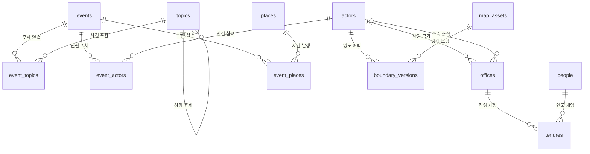

# 연표 프로젝트: 시트 데이터 스키마 v2

작성 기준: 2026-11-17. 이 스키마로 구글 시트를 만들고 웹앱에 읽기 전용으로 연결했다. 원본 노션은 수정하지 않았다. 실제 연결 방식과 입력 범위는 [README](../README.md)를 참조한다.

## 설계 기준

기존 [냉전 연표](https://1851.notion.site/coldwar?v=af68ac6e63b94531a57ec891c654ae29)의 실제 필드는 `년도`, `월`, `일`, `이름`, `사건`, `사건 카테고리`, `미 지도자`, `소 지도자`, `한국 지도자`다. 조회한 전체는 168행이며, 월 미입력 8행, 일 미입력 100행이다. 최소 연도는 1923년, 최대는 1991년이다. 행 수에는 빈 항목이 포함될 수 있다.

`사건`은 이름과 달리 `한국전쟁`, `쿠바위기`, `데탕트` 등의 다중 분류다. 같은 사건이 `한국전쟁`과 `냉전의 군사화`에 동시에 속하는 실제 사례가 있다. `사건 카테고리`가 연결된 별도 DB는 접근되지 않아 그 내부 구조는 확인하지 못했다.

핵심 원칙은 다음과 같다.

- 한 스프레드시트 안의 탭 하나를 테이블 하나로 쓴다. 한 행은 한 사건, 한 인물, 한 재임, 또는 두 항목의 연결 하나다.
- 사건에 `미국 대통령`, `소련 지도자`, `한국 지도자` 열을 늘리지 않는다. 날짜와 국가를 이용해 재임 이력을 조회한다.
- 사건의 실제 참여자, 사건 당시의 지도자, 사건이 일어난 장소는 서로 다른 관계다.
- 사건 하나를 여러 주제에서 재사용한다. 냉전, 미국혁명, 한국근현대사를 각각 복제된 사건 목록으로 만들지 않는다.
- 역사적 국가, 국가의 영토, 국제기구를 구분한다. 국가의 ID는 이름이나 현재 ISO 코드가 바뀌어도 바꾸지 않는다.
- 시트에는 경계의 기간과 파일 참조를 넣는다. 수천 개 좌표로 된 GeoJSON 본문은 파일에 둔다.

## 1. 먼저 만들 탭

탭 이름은 아래 영문 키를 권장한다. 설명은 한국어로 적고, 헤더에 영문 키를 사용한다. UI에서는 한국어 이름으로 보여준다.

| 탭 | 한국어 이름 | 한 행의 의미 | 주요 관계 |
|---|---|---|---|
| `events` | 사건 | 하나의 사건 또는 기간 사건 | 출처 |
| `topics` | 주제 | 냉전, 한국전쟁, 쿠바위기 등 | 상위 주제 |
| `event_topics` | 사건과 주제 | 사건 하나가 주제 하나에 속함 | 사건 ↔ 주제 |
| `actors` | 국가와 조직 | 미국, 소련, 동독, NATO 등 | 출처 |
| `event_actors` | 사건과 국가·조직 | 사건에 실제로 관여한 주체 | 사건 ↔ 국가·조직 |
| `people` | 인물 | 케네디, 흐루쇼프 등 | 출처 |
| `offices` | 직위 | 미국 대통령, 소련 공산당 제1서기 등 | 국가·조직 |
| `tenures` | 재임 이력 | 한 인물이 한 직위를 맡은 기간 | 인물 ↔ 직위 |
| `places` | 장소 | 베를린, 쿠바의 특정 위치 등 | 출처 |
| `event_places` | 사건과 장소 | 사건과 관련 장소 하나 | 사건 ↔ 장소 |
| `sources` | 출처 | 노션 연표, 책, 논문, 데이터셋 등 | 없음 |

실제 시기별 국경을 연결할 때 `map_assets`, `boundary_versions` 2개 탭을 추가한다. 나머지 확장은 8절에 따로 둔다.



출처 연결은 그림을 단순하게 유지하기 위해 생략했다. 아래 `source_id`는 모두 `sources.source_id`를 참조한다.

## 2. 공통 입력 규칙

### ID와 관계

- 각 마스터의 ID는 필수이며, 전체 행에서 유일하다. `evt_cuba_quarantine_1962`, `actor_ussr`, `person_kennedy`처럼 접두어를 붙인다.
- 한 번 부여한 ID는 이름 변경, 정렬, 행 이동 때문에 바꾸지 않는다. 행 번호와 이름을 키로 쓰지 않는다.
- 외래 키 셀에는 ID 하나만 넣는다. `actor_usa,actor_ussr` 같은 쉼표 목록이나 다중 선택을 넣지 않는다.
- 다대다 관계는 연결 탭에 여러 행으로 넣는다. 선택값을 읽기 쉽게 보여주는 이름 열은 수식 보조 열로 둘 수 있지만 가져오기 대상에서 제외한다.
- 첫 행은 헤더다. 병합 셀, 중간 소제목 행, 합계 행을 원본 데이터 범위에 넣지 않는다.
- ID와 날짜 열은 시트에서 **일반 텍스트** 서식으로 지정한다.

### 날짜

날짜는 연·월·일을 각각 선택하는 방식 대신, 정밀도가 보존되는 텍스트로 적는다.

| 알고 있는 범위 | 저장 예 | 의미 |
|---|---|---|
| 연도 | `1962` | 1962년 중 발생, 특정 일자는 모름 |
| 연월 | `1962-10` | 1962년 10월 중 발생, 특정 일자는 모름 |
| 연월일 | `1962-10-22` | 그 날짜에 발생 |

별도 `precision` 열은 두지 않는다. 문자열 형태로 정밀도를 계산한다. 이 초안은 양력 서기 연대를 대상으로 하며, 기원전·음력 변환은 별도 설계 대상이다.

- `events.start_date`는 필수다. `events.end_date`가 비어 있으면 한 시점의 사건이며, 기간을 알 수 없는 진행 중 사건으로 해석하지 않는다.
- 기간 사건은 시작과 끝을 모두 적는다. 끝을 모르는 기간 사건은 `draft`로 두고 `date_note`에 상태를 적는다.
- 기간의 시작일과 종료일은 **모두 포함**한다. 이 규칙은 재임과 경계 이력에도 동일하게 적용한다.
- `actors`, `offices`, `tenures`, `boundary_versions`의 종료일 공란은 출처의 확인 시점까지 이어진다는 의미로만 쓴다. 종료일 미확인을 뜻하는 공란과 섞지 않는다. 종료가 불명확한 사실은 `draft`로 보류한다.
- 일부 날짜만 알려졌다면 가능한 날짜 범위를 계산한다. `1962-10`을 저장하거나 표시할 때 `1962-10-01`로 확정하지 않는다.
- 대략적인 날짜는 `date_qualifier=approximate`, 원문 설명은 `date_note`로 남긴다. 대략적 연도를 정확한 연도처럼 채점하지 않는다.
- 날짜가 빠진 행, 월·일에 여러 값이 있는 행, 존재하지 않는 날짜는 가져오기 단계에서 검토 대상으로 분리한다. 임의로 첫 값만 선택하지 않는다.

### 출처와 검토

`source_id`와 `citation_detail`을 가진 행은 출처 마스터와 해당 쪽수·문단·항목을 연결한다. `origin_ref`는 동기화용 원본 행 참조이며, 출처 검증을 대신하지 않는다.

`review_status` 값은 `draft`, `verified` 두 가지다. `verified`는 해당 내용을 사람이 검토했다는 뜻이며, 출처가 존재하거나 노션에 있었다는 이유만으로 자동 지정하지 않는다. 검토된 사건만 수업·게임용 출력에 포함하고, 자동 지도자 조회에는 검토된 재임만 사용한다.

## 3. 사건과 주제

### `events` 사건

| 열 | 형식 | 필수 | 설명 |
|---|---|---|---|
| `event_id` | ID | O | 사건 고유 키 |
| `title` | 텍스트 | O | 전체 사건명 |
| `short_title` | 텍스트 |  | 게임·작은 카드용 이름. 없으면 title 사용 |
| `start_date` | 부분 날짜 | O | 발생일 또는 시작일 |
| `end_date` | 부분 날짜 |  | 기간 사건의 종료일 |
| `date_qualifier` | 선택 | O | `stated` 또는 `approximate`. 원문 정밀도와 정확성 검토는 별개 |
| `date_note` | 텍스트 |  | 날짜의 근거, 불확실성 |
| `summary` | 텍스트 |  | 사건 설명. 검토된 공개 사건에는 권장 |
| `inquiry_question` | 텍스트 |  | 수업의 탐구 질문 |
| `game_eligible` | 체크박스 | O | 줄 세우기 후보 여부 |
| `review_status` | 선택 | O | `draft`, `verified` |
| `source_id` | FK | O | 대표 출처 |
| `citation_detail` | 텍스트 |  | 출처 안의 위치 |
| `origin_ref` | 텍스트 |  | 기존 노션의 페이지 URL/고유 ID 등. 값이 있는 행끼리 유일 |

초기 게임은 `start_date`를 비교한다. 종료일 기준 문제를 만들고 싶다면 별도 문제 규칙을 추가한 뒤 사용한다. 사건 종료일을 임의로 정렬 키로 쓰지 않는다.

### `topics` 주제

| 열 | 형식 | 필수 | 설명 |
|---|---|---|---|
| `topic_id` | ID | O | 주제 키 |
| `name` | 텍스트 | O | 냉전, 쿠바위기, 독일문제 등 |
| `parent_topic_id` | FK → topics |  | 상위 주제. 최상위는 공란 |
| `description` | 텍스트 |  | 주제 범위 |
| `sort_order` | 정수 | O | 같은 상위 주제 안의 표시 순서 |

예: `topic_coldwar` 아래에 `topic_cuba_crisis`, `topic_korean_war`, `topic_detente`를 둔다. 사건은 여러 하위 주제에 동시에 연결할 수 있다. 하나의 주제 자체가 여러 부모를 갖는 구조는 이 초안에서 두지 않는다.

상위 `냉전`을 선택하면 자손 주제의 사건까지 합쳐 가져오고 `event_id`로 중복을 제거한다. 모든 사건에 상위 주제를 반복해서 연결할 필요는 없다. 분류가 없는 냉전 사건은 최상위 냉전에 직접 연결한다.

### `event_topics` 사건과 주제

| 열 | 형식 | 필수 | 설명 |
|---|---|---|---|
| `event_id` | FK → events | O | 사건 |
| `topic_id` | FK → topics | O | 주제 |

두 열의 조합이 기본 키다. 별도의 행 ID, 쉼표 목록, 동일 연결 중복은 두지 않는다.

## 4. 국가, 조직, 지도자

### `actors` 국가와 조직

| 열 | 형식 | 필수 | 설명 |
|---|---|---|---|
| `actor_id` | ID | O | 시대를 통틀어 식별하는 키 |
| `name` | 텍스트 | O | 기본 표시명 |
| `actor_type` | 선택 | O | `state`, `territory`, `organization` |
| `start_date` | 부분 날짜 |  | 성립일. 확인 전에는 공란과 설명을 보존 |
| `end_date` | 부분 날짜 |  | 소멸일. 국가명·정권 변경만으로 종료시키지 않음 |
| `iso3` | 텍스트 |  | 해당 코드가 있을 때만. 기본 키로 사용하지 않음 |
| `review_status` | 선택 | O | `draft`, `verified`. 존재 기간 미확인 사항은 draft로 보존 |
| `source_id` | FK |  | 실체·성립·소멸의 출처 |
| `citation_detail` | 텍스트 |  | 출처 안의 위치 |
| `notes` | 텍스트 |  | 국가의 연속성·승계에 관한 편집 기준 |

`actor_usa`, `actor_ussr`, `actor_prc`, `actor_roc`, `actor_frg`, `actor_gdr`, `actor_nato`, `actor_cpsu`를 각각 구분할 수 있다. 소련과 러시아, 동독과 서독을 현재 국가 코드 하나로 합치지 않는다. 반대로 정부가 바뀔 때마다 새 국가 ID를 만들지도 않는다. 승계·동일성 기준은 출처를 보고 결정한다.

### `people` 인물

| 열 | 형식 | 필수 | 설명 |
|---|---|---|---|
| `person_id` | ID | O | 인물 키 |
| `name` | 텍스트 | O | 기본 한국어 표시명 |
| `original_name` | 텍스트 |  | 원어명 또는 원문 이름 |
| `source_id` | FK |  | 인물 식별 출처 |
| `notes` | 텍스트 |  | 동명이인, 원본 표기 대응 등 |

`J.F.Kennedy`와 `케네디`는 한 인물에 대응시킨다. 이민·국적 변경과 국가 관계를 이름 행에 하나의 고정 국가로 박지 않는다. 이 프로젝트에서 인물의 국가 관계는 재임과 실제 사건 참여로 조회한다.

### `offices` 직위

| 열 | 형식 | 필수 | 설명 |
|---|---|---|---|
| `office_id` | ID | O | 직위 키 |
| `country_id` | FK → actors | 조건부 | 어느 국가의 지도자 문맥에 보여줄지. 국가 지도자 직위에는 필수 |
| `institution_id` | FK → actors | 조건부 | 정당·국제기구 등 소속 조직. country_id와 둘 중 하나 이상 필수 |
| `title` | 텍스트 | O | 대통령, 공산당 제1서기, 국무원 총리 등 |
| `role_type` | 선택 | O | `head_of_state`, `head_of_government`, `party_leader`, `de_facto_leader`, `other` |
| `start_date` | 부분 날짜 |  | 해당 직위가 존재한 기간의 시작 |
| `end_date` | 부분 날짜 |  | 직위 폐지·변경으로 구분할 때 종료 |
| `display_order` | 정수 | O | 지도자 목록의 표시 순서. 실질 권력의 자동 판정값이 아님 |
| `review_status` | 선택 | O | `draft`, `verified` |
| `source_id` | FK |  | 직위와 소속의 출처 |
| `notes` | 텍스트 |  | 직위명 변경이나 비교 시 주의점 |

예: 미국 대통령은 `country_id=actor_usa`. 소련 공산당 제1서기는 `country_id=actor_ussr`, `institution_id=actor_cpsu`다. 국가원수, 정부수반, 당 지도자를 모두 한 종류의 ‘대통령’으로 취급하지 않는다.

`de_facto_leader`는 공식 직위와 구별한 편집 분류다. 실제 권력자라고 추정해서 채우지 않고, 근거 출처가 있을 때만 등록한다. 직함만으로 그 국가의 수장 한 명을 자동 선택하지 않는다.

### `tenures` 재임 이력

| 열 | 형식 | 필수 | 설명 |
|---|---|---|---|
| `tenure_id` | ID | O | 재임 구간 키 |
| `person_id` | FK → people | O | 재임자 |
| `office_id` | FK → offices | O | 직위 |
| `start_date` | 부분 날짜 | O | 취임·재임 시작 |
| `end_date` | 부분 날짜 |  | 재임 종료. 공란의 의미는 공통 규칙 참조 |
| `date_qualifier` | 선택 | O | `stated`, `approximate` |
| `appointment_type` | 선택 | O | `regular`, `acting`, `interim` |
| `review_status` | 선택 | O | `draft`, `verified` |
| `source_id` | FK | O | 재임 기간의 근거 |
| `citation_detail` | 텍스트 |  | 쪽수·항목 |
| `notes` | 텍스트 |  | 교체일, 공동 재임, 날짜 불확실성 |

한 사람이 여러 직위를 겸하면 여러 행으로 적는다. 같은 직위에 재취임하면 떨어진 기간은 별도 행으로 적는다. 한 직위의 공식 재임과 권한대행을 섞어서 덮어쓰지 않는다.

**그 시기 지도자 조회**

1. 연표의 선택 날짜, 또는 사건의 가능한 날짜 범위를 구한다.
2. 보고 싶은 국가의 `offices`를 찾는다. 관련 조직 수장은 `institution_id`로도 조회할 수 있다.
3. 직위별 `tenures`와 날짜가 겹치는 구간을 찾는다.
4. `people`을 연결해 이름과 직위를 표시한다.

`events → event_actors → actors → offices → tenures → people`로 사건 관련 국가의 지도자를 얻을 수 있다. 다만 미국·소련·중국·남북한을 계속 비교하는 화면에서는 **화면에 선택된 국가 목록**으로 offices를 조회한다. 사건에 참여하지 않은 미국을 지도자 표시 목적으로 event_actors에 억지로 연결하지 않는다.

그 달에 지도자가 교체되었는데 사건 날짜가 월까지만 알려진 경우에는 둘 다 후보로 보여주고 `교체 시기와 겹침`을 표시한다. 같은 날짜의 교체 전후를 일 단위 자료만으로 판정하지 않는다. 기간 사건에는 그 기간을 거친 여러 지도자가 나올 수 있다.

더 엄밀한 판정이 필요하면 부분 날짜에서 경계를 계산한다. 재임 시작의 가능한 범위를 `[S최소,S최대]`, 종료의 가능한 범위를 `[E최소,E최대]`라고 할 때, 가능한 재임은 `[S최소,E최대]`, 확실하게 재임한 범위는 `[S최대,E최소]`다. 확실한 범위가 비어 있을 수도 있다. 사건의 가능한 날짜 범위 전체가 확실한 재임 안에 들어갈 때만 단일 재임을 확정한다. `approximate`는 이 계산만으로 확정하지 않는다.

### `event_actors` 사건과 국가·조직

| 열 | 형식 | 필수 | 설명 |
|---|---|---|---|
| `event_id` | FK → events | O | 사건 |
| `actor_id` | FK → actors | O | 국가·조직 |
| `role` | 선택 | O | `initiator`, `counterparty`, `participant`, `mediator`, `affected` |
| `notes` | 텍스트 |  | 사건에서 맡은 역할의 설명 |
| `source_id` | FK → sources |  | 별도로 확인한 국가 역할의 근거. 공란이면 사건 출처 상속 |
| `citation_detail` | 텍스트 |  | 근거의 페이지·문단·문서 번호 |

기본 키는 `(event_id, actor_id, role)`. 별도 조사 근거는 source_id와 citation_detail로 연결한다. 대표 출처가 공란이면 events에서 상속하며 해석의 범위는 notes에 남긴다.

예: 원본의 `1962-10-22 미국의 쿠바 봉쇄` 사건에는 미국·쿠바·소련을 각 행으로 연결한다. 반면 **그때 재임 중이었다는 사실만으로 케네디를 실제 참여자로 자동 등록하지 않는다.** 실제 참여자를 명시하려면 8절의 event_people을 쓴다.

## 5. 장소

### `places`

| 열 | 형식 | 필수 | 설명 |
|---|---|---|---|
| `place_id` | ID | O | 장소 키 |
| `name` | 텍스트 | O | 베를린, 모스크바 등 |
| `latitude` | 숫자 | 조건부 | 지도에 표시할 때 필수, -90~90 |
| `longitude` | 숫자 | 조건부 | 지도에 표시할 때 필수, -180~180 |
| `location_precision` | 선택 | O | `exact_site`, `city`, `region`, `country_representative`, `unknown` |
| `source_id` | FK |  | 위치의 출처 |
| `notes` | 텍스트 |  | 실제 사건 지점인지, 설명용 대표점인지 |

위도·경도는 둘 다 입력하거나 둘 다 비운다. 넓은 지역에 걸친 사건을 수도에서 일어난 일처럼 표시하지 않는다. 수도·대표점을 사용했다면 대표점이라는 사실을 표시한다.

소속 국가를 고정 열로 적지 않는다. 베를린 같은 장소의 시대별 국가·점령 상태는 경계·통제 이력으로 판정해야 한다. 좌표 하나가 항상 같은 국가에 속한다고 가정하지 않는다.

### `event_places`

| 열 | 형식 | 필수 | 설명 |
|---|---|---|---|
| `event_id` | FK → events | O | 사건 |
| `place_id` | FK → places | O | 장소 |
| `role` | 선택 | O | `occurred_at`, `signed_at`, `affected_area`, `representative` |
| `is_primary` | 체크박스 | O | 기본 지도 초점 여부 |

기본 키는 `(event_id, place_id, role)`. 사건당 is_primary=true는 최대 1행이다. 여러 장소가 연결되어도 지도 기본 초점을 결정할 수 있게 한다. 장소가 없는 사건도 허용하며, 임의 좌표를 생성하지 않는다.

## 6. 출처

### `sources`

| 열 | 형식 | 필수 | 설명 |
|---|---|---|---|
| `source_id` | ID | O | 출처 키 |
| `title` | 텍스트 | O | 자료명 |
| `source_type` | 선택 | O | `notion`, `book`, `article`, `website`, `dataset`, `archive` |
| `author_or_publisher` | 텍스트 |  | 저자·기관 |
| `url` | URL |  | 원본 링크. 책 등은 공란 가능 |
| `publication_date` | 부분 날짜 |  | 발행일 |
| `accessed_on` | 연월일 |  | 웹·자료 확인일 |
| `license` | 텍스트 |  | 지도·이미지·데이터 재사용 조건 |
| `notes` | 텍스트 |  | 판본·자료의 범위와 한계 |

같은 책·노션 연표는 한 번 등록하고 여러 사건·재임에서 참조한다. 대표 출처 하나로 시작하되, 한 사건에 여러 출처를 연결할 필요가 생기면 `event_sources(event_id, source_id, citation_detail)` 연결 탭을 추가한다. 그때 events의 대표 source_id는 대표 출처를 고르는 의미로만 남기며, 인용 내용은 연결 탭에서 관리해 이중 편집을 피한다.

## 7. 실제 역사 국경을 위한 탭

### `map_assets`

| 열 | 형식 | 필수 | 설명 |
|---|---|---|---|
| `asset_id` | ID | O | 지도 파일 버전 키 |
| `url` | URL 또는 배포 경로 | O | GeoJSON 등 파일 위치 |
| `format` | 선택 | O | 우선 `geojson` |
| `source_id` | FK | O | 데이터셋 출처와 라이선스 |
| `version` | 텍스트 | O | 원본·편집본 버전 |
| `notes` | 텍스트 |  | 단순화 수준, 편집·보완 내용 |

경도·위도 순서의 WGS84 좌표를 사용한다. 기존 파일을 덮어써 의미를 바꾸지 말고, 버전이 바뀌면 새 asset_id로 관리한다. 좌표의 대량 본문은 시트에 넣지 않는다.

### `boundary_versions`

| 열 | 형식 | 필수 | 설명 |
|---|---|---|---|
| `boundary_version_id` | ID | O | 경계 구간 키 |
| `actor_id` | FK → actors | O | 해당 영토의 국가·통치 주체 |
| `start_date` | 부분 날짜 | O | 적용 시작 |
| `end_date` | 부분 날짜 |  | 적용 종료 |
| `boundary_type` | 선택 | O | `legal`, `control`, `claim` |
| `asset_id` | FK → map_assets | O | 파일 |
| `feature_id` | 텍스트 | O | 파일 속 해당 Feature의 고유 ID |
| `precision` | 선택 | O | `documented`, `approximate`, `uncertain` |
| `review_status` | 선택 | O | `draft`, `verified` |
| `source_id` | FK | O | 해당 경계·기간의 근거. 파일 출처보다 구체적 근거를 둘 수 있음 |
| `citation_detail` | 텍스트 |  | 근거의 위치 |
| `notes` | 텍스트 |  | 분쟁, 편집 관점, 근사 범위 |

국경은 나라의 표시색과 별개다. `1962년 소련의 영토`, `1992년 러시아의 영토`처럼 적용 날짜에 맞는 **도형 자체**를 선택한다. 법적 국경, 전쟁 중 실제 통제선, 영유권 주장은 서로 겹칠 수 있으므로 구분해서 렌더링한다.

Feature 한 개가 고유 구역·분리된 영역을 나타낼 수 있다. 동일 actor와 날짜의 여러 Feature를 무조건 중복으로 삭제하지 않는다. 같은 파일 Feature와 경계 유형의 기간이 중복되거나, 승인 없이 서로 다른 법적 주권 영역이 겹치는 경우 검토한다. 날짜 정밀도가 낮아 교체일을 확정할 수 없으면 지도에 근사·불확실성을 알리거나 해당 시점의 정확한 경계 표시를 보류한다.

데이터가 없는 해에는 가장 가까운 연도의 경계를 해당 해의 실제 국경처럼 표시하지 않는다. 적용 기간이 맞는 자료가 없다고 표시한다.

## 8. 필요할 때 붙일 관계 탭

다음은 처음부터 입력을 요구하지 않는다. 현재 데이터와 기능이 필요로 할 때 추가한다.

| 탭 | 열 | 쓰는 경우 |
|---|---|---|
| `event_people` | `event_id, person_id, role, source_id, citation_detail` | 사건에 실제로 관여한 인물을 명시할 때. role은 `speaker`, `signatory`, `negotiator`, `participant` 등. `(event_id, person_id, role)` 조합이 유일 |
| `event_relations` | `from_event_id, to_event_id, relation_type, source_id, citation_detail, notes` | 사건의 대응·원인 관계를 표시할 때. from → to 방향을 고정하고 단순 연대 순서는 저장하지 않음 |
| `memberships` | `membership_id, member_actor_id, group_actor_id, start_date, end_date, source_id, citation_detail, notes` | NATO 등 조직 가입·탈퇴 이력. member와 group 모두 actors 참조. group은 organization이어야 함 |
| `actor_names` | `actor_name_id, actor_id, name, start_date, end_date, source_id, notes` | 동일 실체의 시대별 국명·조직명. 국가 자체를 새로 만들지 않고 당시 명칭을 표시할 때 |
| `capital_periods` | `capital_period_id, actor_id, place_id, start_date, end_date, capital_type, source_id, notes` | 수도 이동, 임시 수도, 복수 수도를 다룰 때 |

단순히 친미·친소로 분류하려고 memberships를 채우지 않는다. 공식 가입과 연구자의 진영 해석은 구별한다. 진영 해석을 넣는 단계에는 별도 근거와 분류 기준을 확정한다.

`event_relations`의 초기 relation_type은 `causes`(원인), `responds_to`(대응), `part_of`(사건의 구성) 정도로 제한한다. `A responds_to B`는 A가 B에 대응한 사건이라는 뜻이다. 인과관계는 자동 생성하지 않는다. `part_of`의 순환과 자기 참조는 금지한다.

## 9. 기존 냉전 연표 옮기는 규칙

| 기존 필드 | 새 위치 | 이관 규칙 |
|---|---|---|
| 이름 | events.title | 원문 보존. 줄인 이름은 short_title에 따로 작성 |
| 년도 + 월 + 일 | events.start_date | 실제 입력된 정밀도만 사용. 월·일의 다중 값은 검토 대상으로 보류 |
| 사건 | topics + event_topics | `한국전쟁`, `냉전의 군사화` 등의 다중 분류를 각각 연결 행으로 분리 |
| 사건 카테고리 | topics + event_topics 후보 | 연결된 DB를 확인한 뒤 기존 분류와 중복 여부를 결정. 현재 자동 이관하지 않음 |
| 미 지도자 | people + offices + tenures의 대조 자료 | 이름 대응은 만들되, 사건 한 행의 태그로 전체 재임 기간을 추정하지 않음 |
| 소 지도자 | 동일 | 제1서기 등 직위와 재임 구간의 근거를 따로 확인 |
| 한국 지도자 | 동일 | 빈 필드를 당시 지도자가 없었다는 뜻으로 해석하지 않음 |
| 원본 페이지 URL | events.origin_ref | 재가져오기 시 동일 사건을 갱신하는 키로 보존 |
| 페이지 본문·사진 | summary / media_assets / event_media | 168개 원본 페이지를 확인하고 본문 텍스트와 사진 20장을 보존. 사진은 19개 사건과 연결 |

선거·취임·직위 승계는 다른 사실이다. 원본에 ‘당선’이라고 적힌 사건을 재임 시작일로 곧바로 쓰지 않는다. 원문은 보존하고 역사 사실의 정정은 근거와 함께 별도로 검토한다.

이름이 없는 빈 행은 유효 사건으로 가져오지 않는다. 앱의 연도 범위는 실제 시트 사건에서 계산하므로 1923년 배경 사건도 표시한다.

## 10. 한 사건이 실제로 연결되는 모습

원본의 `1962-10-22 미국, 제한적 군사력 사용으로 쿠바 봉쇄` 행을 기준으로 한 **설명용 연결 예시**다. 관계별 역할 및 재임 정보까지 이 예시를 보고 자동으로 verified로 만들지는 않는다.

```text
events
  evt_cuba_quarantine_1962
  title: 미국, 제한적 군사력 사용으로 쿠바 봉쇄(Cuba Quarantine)
  short_title: 미국의 쿠바 해상 봉쇄
  start_date: 1962-10-22
  origin_ref: https://app.notion.com/385434add32c42afba9da294a27b5b38

event_topics
  evt_cuba_quarantine_1962 → topic_cuba_crisis

topics
  topic_cuba_crisis → 상위 topic_coldwar

event_actors
  evt_cuba_quarantine_1962 → actor_usa
  evt_cuba_quarantine_1962 → actor_cuba
  evt_cuba_quarantine_1962 → actor_ussr

지도자 문맥(별도로 검토한 재임 구간과 날짜를 비교)
  actor_usa → office_us_president → tenure_kennedy → person_kennedy
  actor_ussr → office_ussr_party_first_secretary → tenure_khrushchev → person_khrushchev

실제 참여자(명시적 출처가 있을 때만)
  evt_cuba_quarantine_1962 → event_people → person_kennedy
```

사건의 일자가 정정되더라도 케네디·흐루쇼프를 각 사건에서 다시 고치지 않는다. 변경한 날짜로 재임 이력을 다시 조회한다. 특정 인물이 연설·서명했다는 실제 참여 사실은 별도의 연결로 남는다.

## 11. 웹앱이 가져오는 방식

시트는 정규화된 원본으로 두고, 앱은 읽은 후 화면용 객체를 조립한다. 화면에서 쓰기 편하다는 이유로 같은 이름과 재임을 시트 여기저기에 복제하지 않는다.

```text
시트의 각 탭 읽기
→ ID·날짜·관계 검증
→ 검토된 행 선택
→ ID별 조회표 구성
→ 선택 주제의 자손 주제와 연결 사건 찾기
→ 연표용 사건 / 날짜별 지도자 / 날짜별 경계 / 줄 세우기 후보 구성
```

각 화면에서 쓰는 값:

- 연표: 사건 날짜, 설명, 주제, 관련 주체, 선택한 국가의 재임 이력.
- 지도: 선택 날짜에 해당하는 경계 Feature와 사건 장소. 현재 국가 소속을 과거 장소에 고정 적용하지 않음.
- 줄 세우기: verified, game_eligible=true, date_qualifier=stated인 사건의 시작 날짜. 질문 중 날짜를 감추고, 선택 후 실제 정밀도로 공개.

게임에서 `1962`와 `1962-10-22`는 선후를 단정할 수 없다. 두 사건의 가능한 날짜 범위가 겹치면 같은 문제의 비교 대상으로 뽑지 않는다. A의 가능한 가장 늦은 날짜가 B의 가능한 가장 이른 날짜보다 앞설 때만 ‘A가 먼저’로 채점한다. 같은 날짜의 사건도 시간 정보 없이 선후 채점하지 않는다.

앱은 구글 시트를 읽기 전용으로 연동하고, 편집은 교사가 시트에서 한다. 브라우저 코드에 편집 권한이나 서비스 계정 비밀키를 넣지 않는다. 원본 관계 탭의 앱용 열을 모은 `web_feed`만 웹에 게시하며 보관 탭과 내부 메모는 제외한다. 원본 태그는 사건의 초안 문맥으로 보여주고, 게임은 검토 완료·출제 선택된 사건으로 제한한다.

## 12. 가져오기에서 반드시 검사할 것

- 마스터 ID 유일성, 연결 탭 조합 키 유일성, 외래 키 존재 여부.
- 날짜 형식과 실제 달력 유효성. 일만 있고 월이 없거나, 시작의 가장 이른 날짜보다 종료의 가장 늦은 날짜가 앞선 경우는 오류.
- 시작·종료의 불확실성 때문에 순서가 확정되지 않으면 verified로 자동 승격하지 않음.
- 주제의 상위 관계와 사건 part_of 관계의 순환·자기 참조 금지.
- country_id의 actor_type은 state 또는 territory, institution_id는 organization. 둘 다 공란인 office 금지.
- people를 자동 추정해서 생성하거나 태그에서 재임 시작·종료를 추정하지 않음.
- 동일 직위의 재임이 겹치는 구간은 교체일·공동 재임·권한대행 여부 검토. 정상적인 겹침까지 자동 삭제하지 않음.
- 위도·경도 쌍과 범위, 사건당 기본 장소 최대 1개, 대표점의 정밀도 표기.
- 지도 파일에 참조 Feature가 실제로 존재하는지, GeoJSON 형식·좌표·도형 유효성 확인.
- 읽기 실패 시 마지막 정상 데이터로 화면을 유지하고 실패를 알림. 빈 응답을 근거로 원본 사건을 삭제하지 않음.
- 여러 탭의 참조가 검증되지 않은 편집 중 데이터를 한꺼번에 화면에 반영하지 않음. 전체 탭 묶음 검증에 통과한 스냅샷으로 교체.

현재 앱은 공개 CSV 읽기, ID·주제 순환·날짜·관계·좌표 검증, 장애 시 마지막 정상 데이터 유지, 원본 사진 표시와 세 가지 추가 연표 보기를 구현했다. 등록된 미국·소련 지도자 14명의 재임 16구간을 조사해 people→tenures→offices→actors와 sources로 연결했다. 역사 경계 파일의 로딩·도형 검증·시기별 렌더링과 재임 중복의 역사적 판정은 아직 구현하지 않았다.

## 13. 사건 관계 입력 탭

`event_relations`의 기본 키는 `(from_event_id, to_event_id, relation_type)`이다. 필드는 `from_event_id`, `to_event_id`, `relation_type`, `review_status`, `source_id`, `citation_detail`, `notes`다. relation_type은 causes, responds_to, part_of이며 출발 사건을 주어로 읽는다. review_status는 draft 또는 verified다. 같은 주제라는 이유로 인과관계를 만들지 않는다. 앱은 verified 관계만 방향과 근거를 표시한다. 자기 참조, 외래 키 누락, part_of의 순환은 가져오기를 중단한다. 공개 피드에 포함되는 notes에는 수업에서 보여줄 관계 설명만 적는다.
